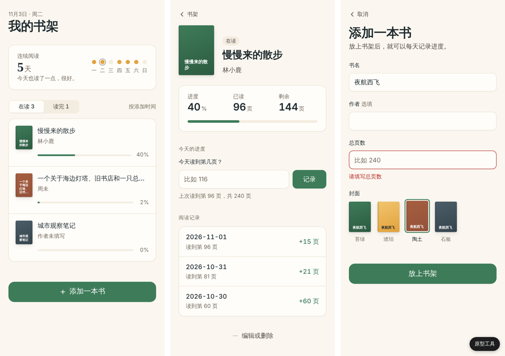

# design-to-dev

[中文](README.md) | English

Turn a design or a product idea into a **prototype that runs**, and hand it off together with the design rules and a handoff document.

design-to-dev is an Agent Skill for people who know design but not much code. Give your AI agent screenshots, a Figma link, brand guidelines, Claude Design output or a short description. It asks a few questions in design language, then returns three things:

| Output | What it is |
| --- | --- |
| `prototype/` | A clickable prototype that opens with a double-click on `index.html`: real navigation, the core flow working end to end, fake data, and hover, empty, loading and error states |
| `design-tokens/` | Your design rules — colors, type, sizes, spacing, radius, shadows, component states — as `tokens.css` (CSS variables) and `tokens.json` (W3C format) |
| `HANDOFF.md` | The handoff: pages, flow diagram, components, interactions, open questions |



Every key element carries a level: **Fixed** (must match), **Indicative** (may be adjusted), **TBD** (the developer or team decides). Press `Shift+A` in the prototype to see them.

## Who it's for

- **UI / UX / product designers** who want developers to receive something they can click through, states included, not just static images.
- **Indie makers and founders** who can design and want a demoable version before deciding how to build it.
- **Developers taking over**, who get a prototype, tokens and a document that says what must match and what is still open.

No coding and no Node.js needed; the prototype needs only a browser.

## How it works

1. **Understand the intent.** Reads all your material, then asks at most five questions (pages and core flow, users and devices, who receives the result, the look, what must match), each with a suggested answer — reply "ok" to accept. The look question is always asked: share your VI / brand guide and 2–3 visual references you like; without them, pick a direction: refined minimal (default), editorial or warm handmade.
2. **Extract the design rules.** Tokens from brand guides, Figma variables or screenshots, each with its source and level; a bundled script reads exact colors and the scale factor from PNG screenshots, and measured sizes are marked Indicative.
3. **Build the prototype.** Plain HTML/CSS/JS, no build step. The "Prototype tools" button switches pages and states, simulates a failed request, and resets the data. Each screenshot is then checked against a 12-point visual QA list (hierarchy, one accent, hairline surfaces, designed placeholders and states, …); with a source design, positions are measured with a script rather than judged by eye.
4. **Mark every item.** Fixed / Indicative / TBD on the elements; every TBD becomes an open question in the handoff.
5. **Write HANDOFF.md**, including a Mermaid flow diagram.
6. **Close in one of two modes:**
   - **A. Hand to a developer** — clarity first, open questions up front.
   - **B. Keep building yourself** — also writes `PLANNER_BRIEF.md`, ready for the planner skill from [Tealun Skills](https://github.com/tealun/Tealun-Skills).

Before handoff the skill runs its bundled checker: both token files match, pages match the document, no hard-coded colors, valid marks, every TBD listed.

## Install

### Claude Code (plugin marketplace)

```text
/plugin marketplace add tealun/design-to-dev
/plugin install design-to-dev@design-to-dev
```

### Tools that support the Agent Skills standard (Claude Code, Codex, Cursor, …)

```bash
npx skills add tealun/design-to-dev
```

Or copy the skill folder to where your tool reads skills:

```bash
git clone https://github.com/tealun/design-to-dev.git
cp -r design-to-dev/skills/design-to-dev ~/.claude/skills/
```

For Codex and other tools that read `~/.agents/skills/`, use that folder instead.

### WorkBuddy and other platforms that take a skill package

Download [`design-to-dev.zip`](design-to-dev.zip) from the repository root and upload it. If the platform needs `SKILL.md` at the zip root, run `python3 scripts/build.py` and upload `dist/design-to-dev-<version>-flat.zip`.

## Examples

Just say what you want:

```text
Here are my app screenshots. Turn them into a clickable prototype for the developers
```

```text
Build an interactive prototype and design tokens from this brand guide and product brief. I'll keep developing it myself
```

```text
Make this Figma file into a prototype: https://www.figma.com/design/…
```

Reading Figma links needs a Figma MCP server connected to your agent; otherwise export each frame as PNG plus a screenshot of the styles.

## Full example

[`examples/readlog/`](examples/readlog/) runs the whole flow on a small reading-tracker product: a text brief and a one-page brand guide go in; a 3-page prototype, 42 tokens, a handoff document and a planner brief come out. Open [`examples/readlog/output/prototype/index.html`](examples/readlog/output/prototype/index.html) to try it.

## Repository layout

```text
skills/design-to-dev/   the skill: SKILL.md, references/, templates/, scripts/
examples/readlog/       full example
docs/                   plan and field-test notes
scripts/build.py        platform checks and packaging
design-to-dev.zip       WorkBuddy upload package (CI keeps it in sync)
```

## License

MIT
