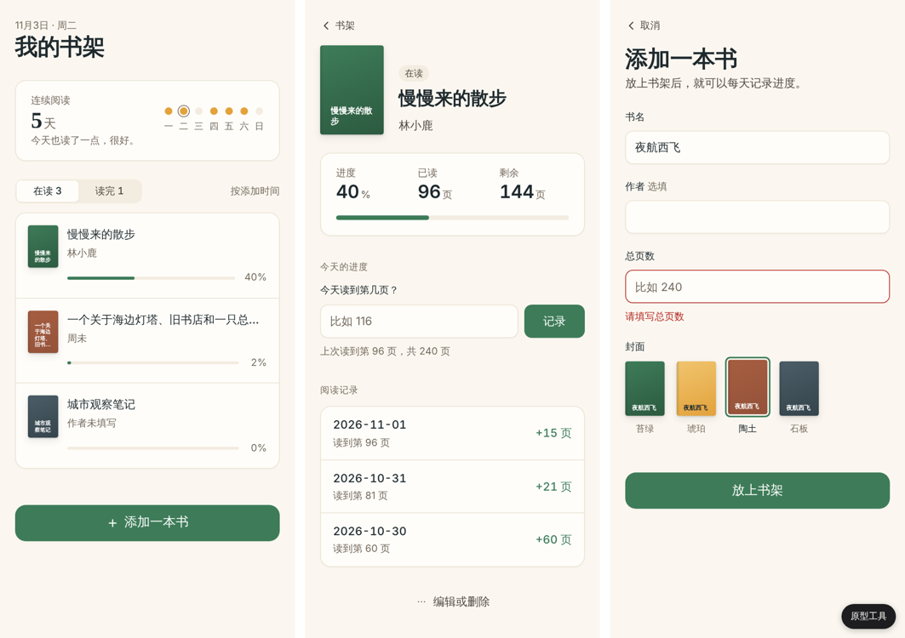

# design-to-dev

中文 | [English](https://github.com/tealun/design-to-dev/blob/main/README.en.md)

把设计稿或产品想法，变成一个**能跑起来的原型**，再连同设计规范和交接文档一起交出去。

design-to-dev 是一个 Agent 技能，给懂设计、不太懂代码的人用。你把截图、Figma 链接、品牌规范、Claude Design 的产出，或者一段文字描述交给 AI，它会问你几个设计师听得懂的问题，然后交回三样东西：

| 产出 | 是什么 |
| --- | --- |
| `prototype/` | 双击 `index.html` 就能打开的可交互原型：页面能点，核心流程能走通，用假数据演示悬停、空状态、加载中和报错 |
| `design-tokens/` | 设计规范：颜色、字体、字号、间距、圆角、阴影、组件状态，`tokens.css`（CSS 变量）和 `tokens.json`（W3C 格式）各一份 |
| `HANDOFF.md` | 交接文档：页面清单、流程图、组件清单、交互细节、待定问题 |



每个关键元素都标了等级：**【确定】**必须还原，**【示意】**可以调整，**【待定】**需要开发决定。在原型里按 `Shift+A` 就能看到。

## 适合谁

- **UI / UX / 产品设计师**：想让开发拿到的不只是静态图，而是能点、能看到各种状态的东西。
- **独立创作者、创业者**：有想法、会设计，想先做一个能演示的版本，再决定怎么开发。
- **接手的开发者**：拿到原型、tokens 和一份写清“哪些必须还原、哪些还没定”的文档。

不需要会写代码，不需要安装 Node.js；原型只要一个浏览器。

## 它怎么工作

1. **理解意图**：读完你的所有材料，一次最多问 5 个问题（页面和核心流程、用户和设备、交给谁、视觉、哪些必须还原），每个问题都带建议答案，回“ok”就行。视觉问题一定会问：请你提供 VI 规范和 2–3 个喜欢的视觉参考；都没有时，从“现代精致极简（默认）/ 编辑杂志感 / 温暖手作感”里选一个方向。
2. **提取设计规范**：从品牌规范、Figma 变量或截图里提取 tokens，每一项写明来源和等级；PNG 截图用自带脚本精确取色并识别倍率，量出来的尺寸标为【示意】。
3. **搭建原型**：纯 HTML/CSS/JS，没有构建步骤。右下角“原型工具”可以切换页面和状态、模拟“请求失败”、重置数据。截图后按 12 项视觉自查逐项检查（层级、单一强调色、细线表面、设计过的占位和状态等）；有原稿时用脚本测量位置，而不是凭目测比对。
4. **逐项标注**：【确定】【示意】【待定】标在元素上；所有【待定】都会进入交接文档的待定问题。
5. **交接文档**：`HANDOFF.md`，含 Mermaid 流程图。
6. **两种收尾**：
   - **A. 交给开发**：文档侧重说清楚，待定问题放在最前面。
   - **B. 自己继续开发**：额外生成 `PLANNER_BRIEF.md`，可以直接交给 [Tealun Dev PDCA](https://github.com/tealun/tealun-dev-pdca) 的 planner 规划下一步。

交付前，技能会运行自带的检查脚本：两份 tokens 是否一致、页面和文档是否对得上、有没有写死的颜色、标注是否合法、待定项是否都进了文档。

## 安装

### Claude Code（tealun 插件市场）

```text
/plugin marketplace add tealun/tealun-plugins
/plugin install design-to-dev@tealun
```

更新：`/plugin marketplace update tealun`。

### claude.ai

在 [Releases](https://github.com/tealun/design-to-dev/releases/latest) 下载 `design-to-dev-<版本>.zip`，然后在 claude.ai 的 Customize > Plugins > Add > Upload plugin 上传。

### WorkBuddy

在 [Releases](https://github.com/tealun/design-to-dev/releases/latest) 下载 `design-to-dev-workbuddy-<版本>.zip`，在 WorkBuddy 的技能上传入口选择它。平台要求 `SKILL.md` 位于压缩包根目录时，改用同一页面的 `-flat.zip`。

### 其他支持 Agent Skills 标准的工具（Codex、Cursor 等）

在 [Releases](https://github.com/tealun/design-to-dev/releases/latest) 下载 `design-to-dev-<版本>.zip` 并解压，把其中的 `skills/design-to-dev` 文件夹放进你的工具读取技能的位置（例如 `~/.claude/skills/` 或 `~/.agents/skills/`）。

## 隐私

技能不收集任何数据。唯一可选的联网是下载字体：`fetch_fonts.py` 会把原型里用到的字符集合发给 Google Fonts，换回只含这些字的字体文件；运行前 Claude 会先问你，你可以拒绝。详见 [PRIVACY.md](https://github.com/tealun/design-to-dev/blob/main/PRIVACY.md)。

## 使用示例

装好后直接说要做的事：

```text
这是我的 App 设计截图，帮我做成能点的原型，交给开发
```

```text
根据这份品牌规范和产品描述，做一个可交互原型和设计规范，我想自己接着往下开发
```

```text
把这个 Figma 链接做成原型：https://www.figma.com/design/…
```

读取 Figma 链接需要 Agent 已连接 Figma MCP；没有的话，导出每个画板的 PNG 和样式截图给它即可。

## 完整示例

[`examples/readlog/`](https://github.com/tealun/design-to-dev/tree/main/examples/readlog) 用一个读书打卡小产品跑通了全流程：输入是一段文字意图和一页品牌规范，产出是 3 个页面的原型（打包了真实字体，离线可用）、82 个 tokens、交接文档和给 planner 的规划输入。

## 仓库结构

```text
skills/design-to-dev/   技能本体：SKILL.md、references/、templates/、scripts/
examples/readlog/       完整示例
docs/                   规划、平台规则对照表、实测记录、审计报告、演进台账
scripts/                本地校验与打包（build_plugin.py、build_suite.py）、plugin 分支发布
tests/                  脚本单元测试与浏览器测试
```

安装包不提交进仓库：推送 `v<版本>` tag 后，由 CI 构建并附在 Release 上；Claude 插件目录跟踪只由 CI 写入的 `plugin` 分支。

## 致谢

视觉方法（设计方向说明、方向菜单、四大支柱、去 AI 味清单）部分借鉴自 zxh 的 frontend-design 技能。

## 许可证

MIT
