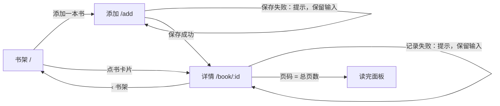

# Readlog 读书打卡 — 交接文档 Handoff

> 由 design-to-dev 生成。原型能点、流程能走通，数据全部是假的，没有后端。
> Generated by design-to-dev. Clickable prototype with fake data and no backend.

| 项 Item | 内容 Value |
| --- | --- |
| 交接对象 Handoff to | B：设计师继续开发（同时可直接交给开发同事阅读） |
| 设计来源 Sources | `input/brief.md` 产品意图（文字）；`input/brand.md` 品牌规范 v0.3 节选。没有视觉稿，版式由 design-to-dev 按品牌规范推导。 |
| 目标用户 Users | 想养成阅读习惯的上班族，睡前读完顺手记录 |
| 设备 Devices | 手机优先（390 宽），桌面端居中显示 |
| 日期 Date | 2026-11-02 |

## 0. 怎么打开 How to open

1. 双击 `prototype/index.html`，用浏览器打开即可，不需要安装任何东西。
2. 右下角“原型工具”：切换页面和状态（默认、空、加载、报错），打开“标注”（或按 Shift+A）查看【确定】【示意】【待定】，勾选“下次请求失败”演示保存失败。
3. 记录过页码或加过书后，点“重置数据”恢复初始假数据。

## 1. 页面清单 Pages

| 页面 Page | 路由 Route | 用途 Purpose | 状态 States | 等级 Level |
| --- | --- | --- | --- | --- |
| 书架 Shelf | `/` | 看在读/读完的书、进度和连续天数，进入详情或添加 | default, empty, loading, error；另有“读完”分栏 `/?tab=done` | 【确定】 |
| 书的详情 Book | `/book/:id` | 看进度，记录今天读到第几页，看历史记录 | default, loading, error；读完后显示庆祝面板 | 【确定】 |
| 添加一本书 Add book | `/add` | 填书名、作者、总页数、封面颜色，放上书架 | default；校验错误；保存中；保存失败 | 【确定】 |

## 2. 流程图 Flow

核心流程 Core flow:

1. 书架点“添加一本书”，填书名和总页数，选封面颜色，点“放上书架”。
2. 保存后直接进入这本书的详情页，提示“已放上书架”。
3. 输入“今天读到第几页”，点“记录”；按钮变为“记录中…”，成功后进度、记录列表更新，提示“记好了，今天也读了一点，很好”。
4. 页码等于总页数时显示“读完了！”，这本书移到书架的“读完”分栏。

## 3. 组件清单 Components

| 组件 Component | 出现位置 Used on | 变体与状态 Variants & states | 等级 Level | 说明 Notes |
| --- | --- | --- | --- | --- |
| 主按钮 Primary button | 全部页面 | default, hover, focus, disabled, busy（“记录中…”） | 【确定】 | 苔绿底白字，手机上通栏，书架和添加页固定在底部 |
| 次按钮 Secondary button | 报错状态 | default, hover, focus | 【示意】 | 纸色底、细边框 |
| 书卡片 Book card | 书架 | hover 描边变苔绿；书名最多两行省略 | 【确定】 | 封面色块 + 书名 + 作者（缺省“作者未填写”）+ 进度条 + 页数百分比 |
| 封面色块 Cover | 书架、详情、添加 | moss / amber / clay / slate；详情页大号 | 【示意】 | 没有真实封面时的占位，显示书名首字 |
| 进度条 Progress bar | 书架、详情 | 0–100% | 【确定】 | 苔绿填充，圆角 |
| 连续打卡卡片 Streak card | 书架 | — | 【示意】 | 琥珀色强调，规则见待定问题 1 |
| 分栏 Tabs | 书架 | 在读 / 读完，选中项白底阴影 | 【确定】 | 数字为本数 |
| 输入框 Field | 详情、添加 | default, focus（苔绿描边+光圈）, error（红框+下方提示） | 【确定】 | |
| 颜色选择 Swatches | 添加 | 未选、选中（墨色描边）、键盘焦点 | 【示意】 | |
| 骨架屏 Skeleton | 加载状态 | 动画；减少动态效果时静止 | 【示意】 | |
| 提示条 Toast | 保存成功/失败 | 默认（墨色）、错误（红色） | 【示意】 | 顶部居中，约 2.5 秒消失 |

素材清单 Assets：

| 素材 Asset | 位置 Where | 状态 Status | 等级 Level |
| --- | --- | --- | --- |
| 书籍封面 Book covers | 书架、详情 | 占位：品牌色块 + 书名首字 | 【示意】 |
| 空书架插图 Empty-shelf illustration | 书架空状态 | 占位：浅琥珀圆形 | 【待定】 |
| 品牌字体 Noto Serif SC | 标题 | 未打包，回退系统宋体 | 【待定】（问题 6） |

## 4. 交互细节 Interactions

| 位置 Where | 触发 Trigger | 结果 Result | 等级 Level |
| --- | --- | --- | --- |
| 书架 | 点书卡片 | 进入该书详情 | 【确定】 |
| 书架 | 点“在读 / 读完” | 切换列表；读完的书 = 当前页等于总页数 | 【确定】 |
| 书架 | 书架为空 | 显示“书架还空着”+“添加第一本书” | 【确定】 |
| 详情 | 页码为空 / 非整数 / 不大于上次 / 超过总页数 | 输入框变红，下方显示对应提示，不提交 | 【确定】 |
| 详情 | 点“记录” | 按钮禁用并显示“记录中…”，约 0.7 秒后成功：更新进度、追加记录、提示 | 【确定】 |
| 详情 | 记录失败 | 红色提示“没记上，网络好像不太好，再试一次”，保留输入，按钮恢复 | 【确定】 |
| 详情 | 当天第一次记录 | 连续天数 +1（原型简化规则） | 【待定】 |
| 添加 | 书名为空或超过 60 字、总页数不在 1–5000 | 对应字段报错，焦点移到第一个错误字段 | 【示意】 |
| 添加 | 保存成功 / 失败 | 成功进入详情并提示“已放上书架”；失败提示并保留输入 | 【确定】 |
| 全局 | 键盘 Tab | 所有按钮、链接、输入框有可见焦点环 | 【确定】 |

## 5. 设计规范 Design tokens

文件 Files: `design-tokens/tokens.css`（CSS 变量），`design-tokens/tokens.json`（W3C 格式，含每项等级与来源），共 42 项。

| 类别 Group | 关键值 Key values | 等级 Level |
| --- | --- | --- |
| 颜色 Color | Moss `#3E7C59` 主色；Amber `#E3A23B` 成就；Ink `#1F2A2E` 文字；Paper `#FBF7F0` 背景 | 【确定】（品牌规范） |
| 派生色 Derived | hover `#346B4C`、浅琥珀 `#FBEDD4`、表面 `#F3ECE0`、边框、弱文字 `#6B6459`、错误 `#B3261E` | 【示意】 |
| 字体 Type | 标题 Noto Serif SC 粗体；正文系统无衬线；字号 14/16/20/24/32；行高 1.6 | 字体【确定】，字号【示意】 |
| 间距与圆角 Space & radius | 4px 基数；圆角 6/12/全圆 | 【示意】 |
| 尺寸 Size | 触控目标 48px；内容最宽 480px | 触控【确定】 |

对比度 Contrast：白字/苔绿 4.96:1，弱文字/纸色 5.47:1，墨色/琥珀 6.65:1，均达到 WCAG AA。琥珀封面上用墨色字（白字只有 2.2:1）。

## 6. 标注等级 Spec levels

- 【确定】Fixed：必须按设计还原。
- 【示意】Indicative：表达意图，可在 tokens 范围内调整。
- 【待定】TBD：未决定，需开发或团队决定，全部列在第 8 节。

| 等级 Level | 原型标注 Marks | 主要内容 Main items |
| --- | --- | --- |
| 【确定】 | 9 | 标题字体、主按钮、书卡片、分栏、进度面板、记录表单与校验、空书架、书名必填 |
| 【示意】 | 5 | 连续打卡卡片、骨架屏、记录列表、读完面板、封面颜色 |
| 【待定】 | 5 | 连续天数规则、排序规则、总页数上限、编辑/删除、加载失败重试 |

## 7. 给开发的说明 Notes for developers

- 原型结构：`index.html` 入口；`styles.css` 只使用 token 变量；`data.js` 假数据；`pages.js` 三个页面各一个 `Proto.page()`；`proto-kit.js` 是原型脚手架（路由、状态切换、模拟请求、标注层），正式开发时替换，不要照搬。
- 需要真实接口的位置：`pages.js` 中两处 `Proto.fake()`（记录页码、添加书籍）以及书架/详情的加载。
- 数据结构参考 `data.js`：书 `{ id, title, author, totalPages, currentPage, cover, logs[{date, page}] }`，用户 `streakDays`。
- 没有覆盖：账号与同步、编辑/删除书籍、真实封面、提醒通知、深色模式、多语言。
- 品牌字体 Noto Serif SC 未随原型打包，原型里回退到系统宋体；见待定问题 6。

## 8. 待定问题 Open questions

| # | 问题 Question | 建议 Suggested answer | 谁来决定 Owner | 影响 Affects |
| --- | --- | --- | --- | --- |
| 1 | 连续天数怎么算？按自然日还是 24 小时？漏一天是否清零？ | 按用户本地自然日；漏一天清零，但提供“补记昨天” | 产品 + 设计 | 连续打卡卡片、记录逻辑 |
| 2 | 书架排序：添加时间还是最近记录？ | 在读按最近记录在前，读完按读完时间倒序 | 设计 | 书架列表 |
| 3 | 总页数上限和电子书（没有页数）怎么办？ | 上限 5000；电子书允许改记百分比 | 产品 | 添加页、详情页 |
| 4 | 是否需要编辑、删除书籍？入口放哪？ | 需要；放在详情页右上角“更多”菜单 | 设计 | 详情页 |
| 5 | 加载失败是否自动重试？ | 自动重试 1 次，仍失败显示当前报错状态 | 开发 | 书架、详情 |
| 6 | 品牌字体如何加载（体积大）？ | 只对标题子集化加载，正文用系统字体 | 开发 | 全局 |
