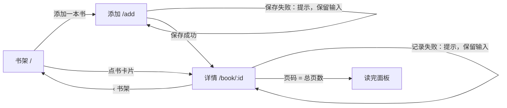

# Readlog 读书打卡 — 交接文档 Handoff

> 由 design-to-dev 生成。原型能点、流程能走通，数据全部是假的，没有后端。
> Generated by design-to-dev. Clickable prototype with fake data and no backend.

| 项 Item | 内容 Value |
| --- | --- |
| 交接对象 Handoff to | B：设计师继续开发（同时可直接交给开发同事阅读） |
| 设计来源 Sources | `input/brief.md` 产品意图（文字）；`input/brand.md` 品牌规范 v0.3 节选。没有视觉稿和视觉参考，设计师选择了“现代精致极简”方向，版式按该方向与品牌规范推导。 |
| 目标用户 Users | 想养成阅读习惯的上班族，睡前读完顺手记录 |
| 设备 Devices | 手机优先（390 宽），桌面端居中显示 |
| 日期 Date | 2026-11-02 |

## 设计方向 Design direction

- **用途**：睡前 30 秒的读书记录，给想养成阅读习惯的上班族，在手机上单手完成。
- **调性**：现代精致极简，做在纸面上：暖白纸色、细线代替卡片、大量留白，只有一处戏剧性：书本身。
- **字体**：展示字 Noto Serif SC Bold（品牌规定），书架标题 32px、连续天数 64px，字距 −0.02em；正文 Noto Sans SC 400/500，15px，行高 1.55。两者均按页面实际用字打包子集（共 165KB），离线可用。
- **颜色**：纸色 `#FBF7F0` 占主导；墨色 `#1F2A2E` 与两级暖灰承担文字；苔绿 `#3E7C59` 是唯一的操作强调色（主按钮、进度、选中）；琥珀 `#E3A23B` 用于连续阅读的打点，也是四种封面色之一，不用于操作。
- **记忆点**：书架上的书看起来像真书：带书脊阴影的封面、宋体书名；还有一个像笔记本页边一样的大号宋体连续天数。
- **氛围**：极淡的纸张颗粒；页面进入时，标题、天数、书单依次浮现（间隔 80ms）。

## 0. 怎么打开 How to open

1. 双击 `prototype/index.html`，用浏览器打开即可，不需要安装任何东西。
2. 右下角“原型工具”：切换页面和状态（默认、空、加载、报错），打开“标注”（或按 Shift+A）查看【确定】【示意】【待定】，勾选“下次请求失败”演示保存失败。
3. 记录过页码或加过书后，点“重置数据”恢复初始假数据。

## 1. 页面清单 Pages

| 页面 Page | 路由 Route | 用途 Purpose | 状态 States | 等级 Level |
| --- | --- | --- | --- | --- |
| 书架 Shelf | `/` | 看在读/读完的书、进度和连续天数，进入详情或添加 | default, empty, loading, error；另有“读完”分栏 `/?tab=done` | 【确定】 |
| 书的详情 Book | `/book/:id` | 看进度，记录今天读到第几页，看历史记录 | default, loading, error；读完后显示庆祝面板 | 【确定】 |
| 添加一本书 Add book | `/add` | 填书名、作者、总页数、封面颜色，放上书架 | default；校验错误；保存中；保存失败 | 【确定】 |

## 2. 流程图 Flow

核心流程 Core flow:

1. 书架点“添加一本书”，填书名和总页数，选封面颜色，点“放上书架”。
2. 保存后直接进入这本书的详情页，提示“已放上书架”。
3. 输入“今天读到第几页”，点“记录”；按钮变为“记录中…”，成功后进度、记录列表更新，提示“记好了，今天也读了一点，很好”。
4. 页码等于总页数时显示“读完了！”，这本书移到书架的“读完”分栏。

## 3. 组件清单 Components

| 组件 Component | 出现位置 Used on | 变体与状态 Variants & states | 等级 Level | 说明 Notes |
| --- | --- | --- | --- | --- |
| 主按钮 Primary button | 全部页面 | default, hover, active, focus, disabled, busy（“记录中…”） | 【确定】 | 苔绿底白字；书架和添加页为 48px 通栏并固定在底部，详情页与输入框同高并排 |
| 次按钮 / 文字按钮 Secondary / ghost | 报错状态、详情页“编辑或删除” | default, hover, focus | 【示意】 | 暖白底细边框 / 无底色 |
| 书目行 Book row | 书架 | hover 时书名变苔绿；书名单行省略 | 【确定】 | 直接放在纸面上，行与行之间用细线分隔，不用卡片：书本式封面 + 书名 + 作者（缺省“作者未填写”）+ 细进度条与百分比 |
| 封面 Cover | 书架（44px）、添加（72px）、详情（104px） | moss / amber / clay / slate | 【示意】 | 5:7 比例，渐变 + 书脊阴影 + 印刷色带 + 宋体书名；小封面只显示首字作装饰；详情页大封面是唯一的“戏剧性阴影”；没有真实封面时的占位 |
| 连续阅读 Streak | 书架 | 已读（琥珀实心点）、未读（空心点）、今天（墨色外圈） | 【示意】 | 64px 宋体天数像笔记本页边，配本周 7 天打点；下方细线收尾；规则见待定问题 1 |
| 分段切换 Segmented control | 书架 | 在读 / 读完，选中项暖白底轻阴影 | 【确定】 | 数字为本数，等宽数字 |
| 数据组 Stats | 详情 | — | 【确定】 | 进度 / 已读 / 剩余三列，宋体大数字（等宽数字），竖细线分隔，上下细线收边 + 4px 进度条 |
| 输入框 Field | 详情、添加 | default, hover, focus（苔绿描边 + 光圈）, error（红框 + 下方提示，编辑后立即消失） | 【确定】 | 44px 高 |
| 封面选择 Cover picker | 添加 | 未选、选中（苔绿外圈）、键盘焦点；预览实时显示输入的书名 | 【示意】 | |
| 状态视图 Empty / loading / error | 书架、详情 | 图标圆 + 一句话 + 一个操作；骨架屏与列表同形 | 【确定】（空状态）/【示意】 | |
| 提示条 Toast | 保存成功/失败 | 默认（墨色）、错误（红色） | 【示意】 | 顶部居中，约 2.5 秒消失 |

素材清单 Assets：

| 素材 Asset | 位置 Where | 状态 Status | 等级 Level |
| --- | --- | --- | --- |
| 书籍封面 Book covers | 书架、详情、添加 | 占位：品牌色渐变 + 书名 | 【示意】 |
| 图标 Icons | 全部页面 | 内联线性图标（16px，1.5px 描边），可换成正式图标库 | 【示意】 |
| 字体 Noto Serif SC 700 / Noto Sans SC 400·500 | 全部页面 | 已打包子集（`prototype/fonts/`，168KB，SIL OFL），只含原型里用到的字；新输入的生僻字回退系统字体 | 字族【确定】/ 加载方式【待定】（问题 6） |

## 4. 交互细节 Interactions

| 位置 Where | 触发 Trigger | 结果 Result | 等级 Level |
| --- | --- | --- | --- |
| 书架 | 点书卡片 | 进入该书详情 | 【确定】 |
| 书架 | 点“在读 / 读完” | 切换列表；读完的书 = 当前页等于总页数 | 【确定】 |
| 书架 | 书架为空 | 显示“书架还空着”+“添加第一本书” | 【确定】 |
| 详情 | 页码为空 / 非整数 / 不大于上次 / 超过总页数 | 输入框变红，下方显示对应提示，不提交 | 【确定】 |
| 详情 | 点“记录” | 按钮禁用并显示“记录中…”，约 0.7 秒后成功：更新进度、追加记录、提示 | 【确定】 |
| 详情 | 记录失败 | 红色提示“没记上，网络好像不太好，再试一次”，保留输入，按钮恢复 | 【确定】 |
| 详情 | 当天第一次记录 | 连续天数 +1（原型简化规则） | 【待定】 |
| 添加 | 书名为空或超过 60 字、总页数不在 1–5000 | 对应字段报错，焦点移到第一个错误字段 | 【示意】 |
| 添加 | 保存成功 / 失败 | 成功进入详情并提示“已放上书架”；失败提示并保留输入 | 【确定】 |
| 全局 | 键盘 Tab | 所有按钮、链接、输入框有可见焦点环 | 【确定】 |

## 5. 设计规范 Design tokens

文件 Files: `design-tokens/tokens.css`（CSS 变量），`design-tokens/tokens.json`（W3C 格式，含每项等级与来源），共 82 项。视觉方向：现代精致极简预设，受品牌规范约束。

| 类别 Group | 关键值 Key values | 等级 Level |
| --- | --- | --- |
| 品牌色 Brand | Moss `#3E7C59` 主操作与进度；Amber `#E3A23B` 只用于连续阅读；Ink `#1F2A2E` 文字；Paper `#FBF7F0` 页面背景 | 【确定】（品牌规范） |
| 中性色 Neutrals | 表面 `#FFFDF9`、凹陷 `#F3ECE0`、细边框 `#EBE3D4`；文字二级 `#4F4A42`、三级 `#74695C` | 【示意】 |
| 字体 Type | 展示 Noto Serif SC 700（标题 32px、天数 64px、数据 32px，字距 −0.01 ~ −0.04em）；正文 Noto Sans SC 400/500；字号 12/13/15/17/20/24/32；数字等宽 | 字体【确定】，字号【示意】 |
| 间距与圆角 Space & radius | 4px 基数；圆角 6/8/12/16/全圆（封面 2/4 模仿书角） | 【示意】 |
| 阴影 Shadow | 极轻的纸面阴影；封面单独一档 | 【示意】 |
| 尺寸 Size | 控件 44px、通栏主按钮 48px【确定】；内容最宽 440px（不含两侧留白）【示意】 | 见左 |

视觉自查 Visual QA：A（`check_output.py`）0 条警告。B（截图观察）：焦点是书架的 64px 宋体天数与详情页大封面；记忆点（书本式封面、页边式天数）首屏可见；强调色只出现在主按钮、进度条、选中的分段与封面选中框；未发现去 AI 味清单中的问题；空、加载、报错状态与默认状态同一语言；入场为标题、天数、书单依次浮现。审美定稿：待设计师评审。

对比度 Contrast（`palette.py --contrast` 计算）：Ink/Paper 13.76:1；二级文字/Paper 8.23:1；三级文字/Paper 5.02:1、/表面 5.28:1；白字/Moss 4.96:1；Ink/琥珀封面 8.98:1；白字/陶土封面 4.89:1。均达到 WCAG AA。

## 6. 标注等级 Spec levels

- 【确定】Fixed：必须按设计还原。
- 【示意】Indicative：表达意图，可在 tokens 范围内调整。
- 【待定】TBD：未决定，需开发或团队决定，全部列在第 8 节。

| 等级 Level | 原型标注 Marks | 主要内容 Main items |
| --- | --- | --- |
| 【确定】 | 9 | 标题字体、主按钮、书目行、分栏、进度数据组、记录表单与校验、空书架、书名必填 |
| 【示意】 | 5 | 连续打卡卡片、骨架屏、记录列表、读完面板、封面颜色 |
| 【待定】 | 5 | 连续天数规则、排序规则、总页数上限、编辑/删除、加载失败重试 |

## 7. 给开发的说明 Notes for developers

- 原型结构：`index.html` 入口；`styles.css` 只使用 token 变量；`data.js` 假数据；`pages.js` 三个页面各一个 `Proto.page()`；`proto-kit.js` 是原型脚手架（路由、状态切换、模拟请求、标注层），正式开发时替换，不要照搬。
- 需要真实接口的位置：`pages.js` 中两处 `Proto.fake()`（记录页码、添加书籍）以及书架/详情的加载。
- 数据结构参考 `data.js`：书 `{ id, title, author, totalPages, currentPage, cover, logs[{date, page}] }`，用户 `streakDays`。
- 没有覆盖：账号与同步、编辑/删除书籍、真实封面、提醒通知、深色模式、多语言。
- 字体已按原型用字子集化打包在 `prototype/fonts/`（`fetch_fonts.py` 生成，改文案后需重跑）；正式产品的字体加载方式见待定问题 6。

## 8. 待定问题 Open questions

| # | 问题 Question | 建议 Suggested answer | 谁来决定 Owner | 影响 Affects |
| --- | --- | --- | --- | --- |
| 1 | 连续天数怎么算？按自然日还是 24 小时？漏一天是否清零？ | 按用户本地自然日；漏一天清零，但提供“补记昨天” | 产品 + 设计 | 连续打卡卡片、记录逻辑 |
| 2 | 书架排序：添加时间还是最近记录？ | 在读按最近记录在前，读完按读完时间倒序 | 设计 | 书架列表 |
| 3 | 总页数上限和电子书（没有页数）怎么办？ | 上限 5000；电子书允许改记百分比 | 产品 | 添加页、详情页 |
| 4 | 是否需要编辑、删除书籍？入口放哪？ | 需要；放在详情页右上角“更多”菜单 | 设计 | 详情页 |
| 5 | 加载失败是否自动重试？ | 自动重试 1 次，仍失败显示当前报错状态 | 开发 | 书架、详情 |
| 6 | 正式产品如何加载中文字体（全量体积大）？ | 标题宋体按页面用字动态子集化；正文可用系统字体或同样子集化 | 开发 | 全局 |
